# The Presentation Game

**A live party game for groups.** Put it on the TV, and everyone scans a QR code and plays on their phone: guess the meaning of words, drop pins where photos were taken, caption the best shots, answer questions and vote on each other's answers. Use it to present something, such as a trip, a hobby or a year in review, or just have fun with your own ideas. The night ends on a podium and an optional page of tips to take home.

You build the night in a deck: your words, your photos, your questions. Nobody needs an account or an app, and it runs on one small server.

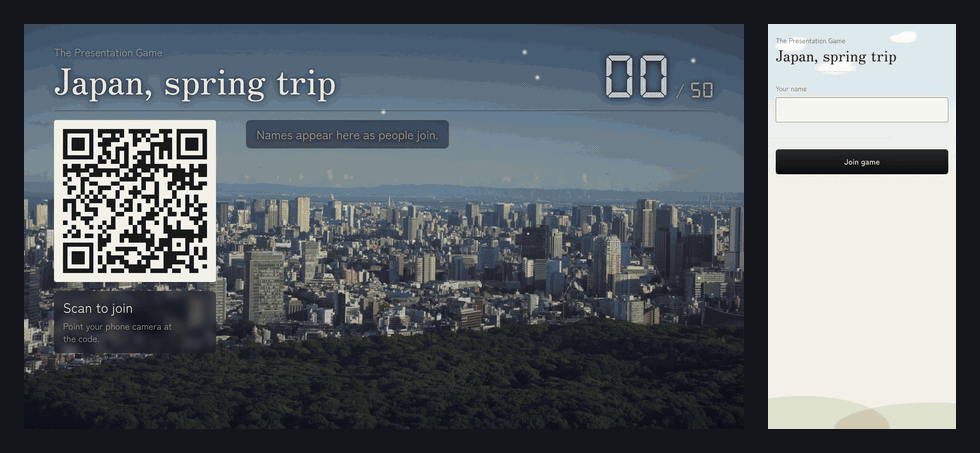

## The games

<table>
  <tr>
    <td width="72%">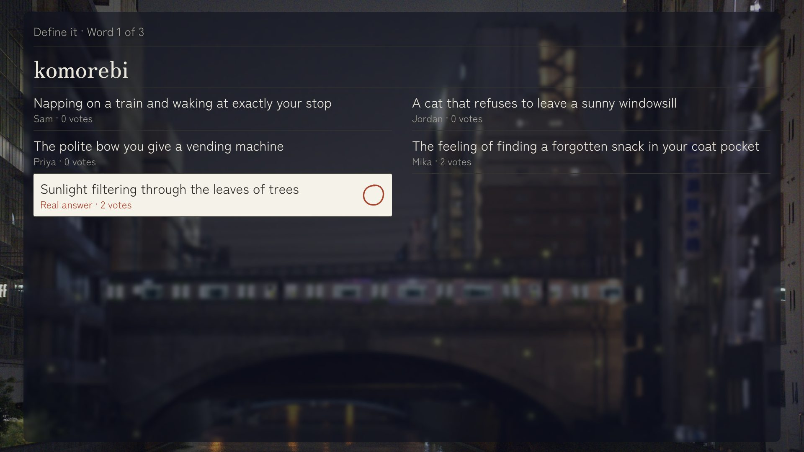</td>
    <td>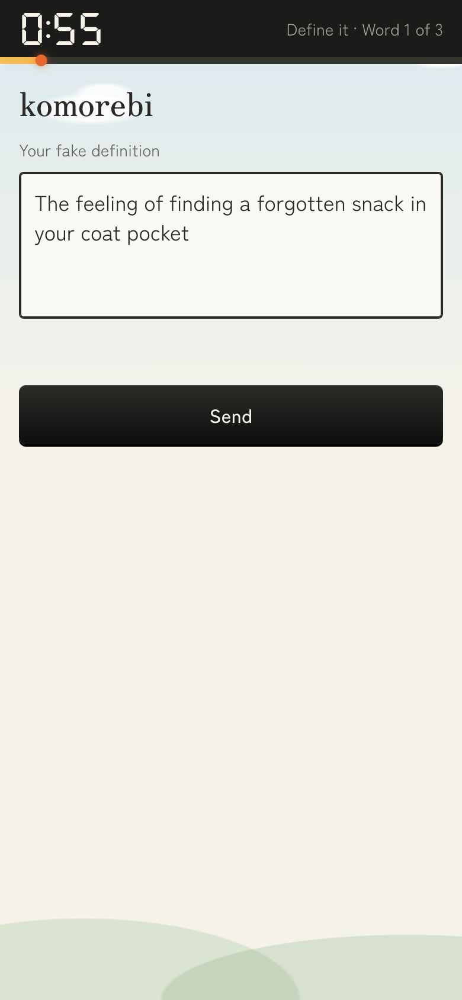</td>
  </tr>
  <tr>
    <td colspan="2"><b>Define it.</b> A real word goes up. Everyone writes a fake meaning, then votes for the one they think is real. You score for finding it, and for every friend your fake fooled. Words can come with a clip of someone saying them.</td>
  </tr>
  <tr>
    <td>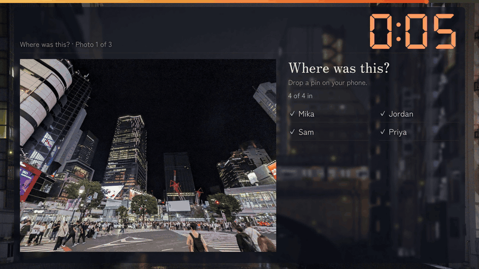</td>
    <td>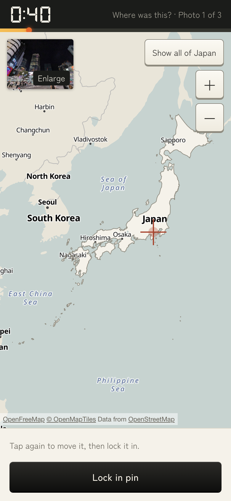</td>
  </tr>
  <tr>
    <td colspan="2"><b>Where was this?</b> A photo goes up and everyone drops a pin on a street map of the country. The closer you are, the more you score.</td>
  </tr>
  <tr>
    <td>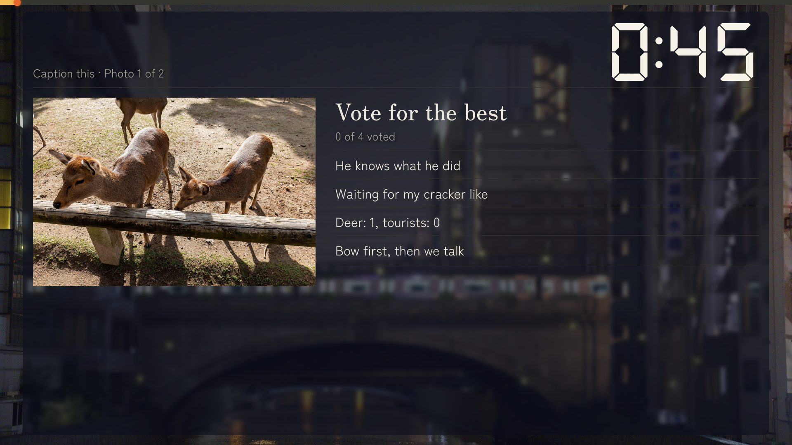</td>
    <td>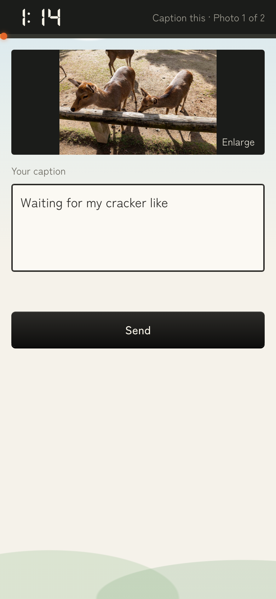</td>
  </tr>
  <tr>
    <td colspan="2"><b>Caption this.</b> Everyone captions the same photo, then votes for the best one that isn't theirs.</td>
  </tr>
  <tr>
    <td>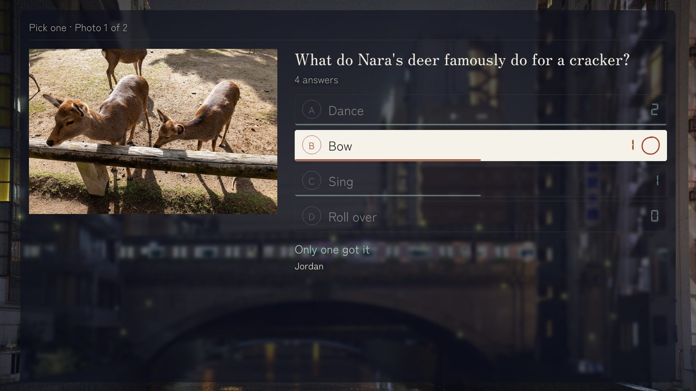</td>
    <td>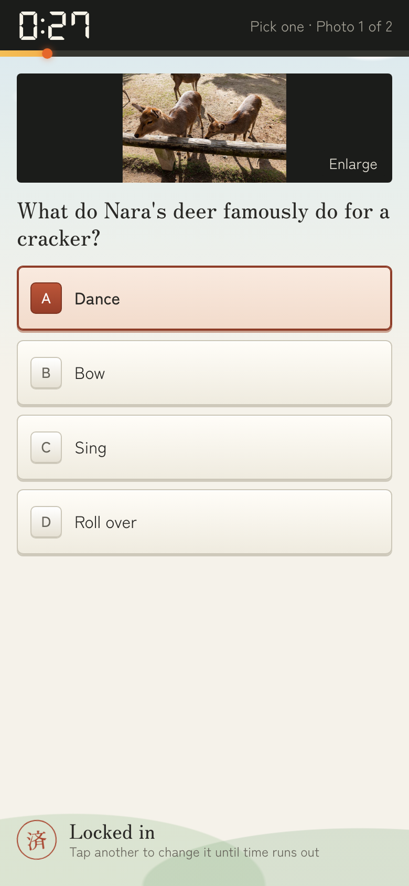</td>
  </tr>
  <tr>
    <td colspan="2"><b>Pick one.</b> A photo, a question and four answers. The TV shows how everyone split, then circles the right one.</td>
  </tr>
</table>

Each photo can bring up to 5 more from the same moment, pinned up on the TV after its round so you can tell the story behind it.

### The finale

The podium lands one place at a time, and each phone learns its place only when the TV shows it. Then an optional page of tips goes up on the TV and on every phone, with each place a tap away in Maps.

<table>
  <tr>
    <td width="50%">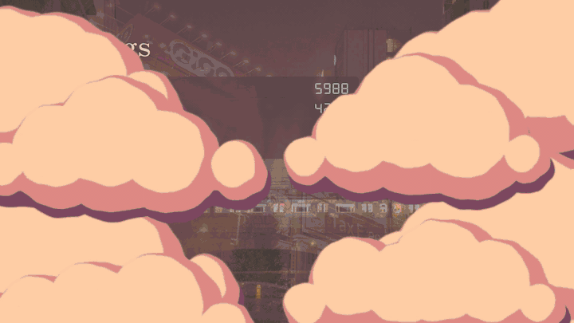</td>
    <td width="50%">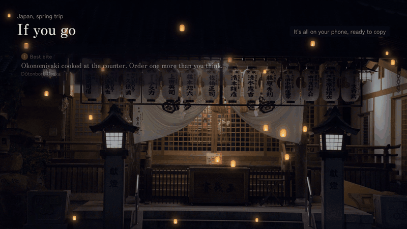</td>
  </tr>
</table>

## Run it yourself in two minutes

You need [Node.js 22](https://nodejs.org) or newer.

```bash
git clone https://github.com/dillonco/presentation-game.git
cd presentation-game
npm install
npm run setup
npm run dev
```

`npm run setup` makes a `.env` file with a presenter password and prints the password. Open http://localhost:5173/admin, sign in with it, and press **Add the sample deck**. It has all four games, with free-to-use photos from Japan. Press **Start game**, then open the join link in another window, or a few, to play along.

Or let sample players fill the room. Leave the lobby on the TV page, and in another terminal run this with the link from that page's address bar:

```bash
npm run players -- http://localhost:5173/host/<room> --count 4
```

They write, vote, drop pins and pick answers like guests' phones would, while you press `Space` on the TV.

The sample deck and sample players are for trying the game while you develop. A server running with `NODE_ENV=production`, as the Docker image does, has no sample deck: every deck on it is one somebody made.

## Play it on the night

Phones join by scanning the QR code on the TV, so they need to reach the server at the address the TV shows.

**On your Wi-Fi.** Build it and run it on a laptop plugged into the TV:

```bash
npm run build
npm start
```

Open `http://<your laptop's network address>:3000/admin` on the laptop, not `localhost`, so the QR code points somewhere phones can reach. Everyone needs to be on the same Wi-Fi.

**With Docker.** [`compose.yaml`](compose.yaml) runs the app with its decks and photos in a volume:

```bash
npm run setup
docker compose up -d
```

**On a host.** Guests on mobile data need a public HTTPS address. The [`Dockerfile`](Dockerfile) runs anywhere that runs containers, and `/healthz` answers `{"ok":true}` for health checks. Set the environment below. If the host wipes the disk on each deploy, use S3 storage so decks and photos survive.

| Variable | |
| --- | --- |
| `ADMIN_PASSWORD` | The presenter password for `/admin`. Required to build decks. |
| `SESSION_SECRET` | 16 characters or more, for signing presenter sessions. Required. |
| `PORT` | Defaults to `3000`. |
| `DATA_DIR` | Where decks, photos and saved games live without S3. Defaults to `.data`. |
| `S3_BUCKET`, `S3_ACCESS_KEY`, `S3_SECRET_KEY` | Store everything in S3 instead of on disk. |
| `S3_REGION` | Defaults to `us-east-1`. |
| `S3_ENDPOINT_URL` | For MinIO, Cloudflare R2 and other S3-compatible stores. Leave it out for Amazon S3. |
| `MEDIA_CACHE_MB` | How much local disk the copy of photos and videos may use. Defaults to `2048`. |
| `HOSTED` | `true` to let anyone use your server. See below. |
| `MAX_SPACES` | How many spaces a hosted server keeps at once. Defaults to `5000`. |
| `TRUST_PROXY` | How many proxies are in front of the server, usually `1` on a host. Then each visitor gets their own limits on new spaces, code guesses and connections. Leave it out when nothing is in front, or anyone could claim any address. |

[`.env.example`](.env.example) lists them all. A game in progress is saved as it goes, so a restart or redeploy only pauses it: the TV and phones reconnect by themselves, on the same screen, with their answers and scores. Still, don't deploy during the party.

A game holds up to 50 guests. Before a big night, [`docs/rehearsal.md`](docs/rehearsal.md) is a checklist for trying it on the real TV and phones, including a load test.

### Letting anyone use it

With `HOSTED=true`, anyone who opens the server can press **Make my space** and start building, with no account. Each space gets a 6-letter join code: the TV shows it under the QR code, and guests can type it on the home page instead of scanning. The browser that made the space is its presenter. A private presenter link, shown in the space, signs in another device.

Each space only ever sees its own decks, photos and games, and the TV only runs for the space that started the game. A space can keep 20 decks and 400 photos (10 of them videos), and run 2 games at once. A space nobody uses for 180 days is deleted with everything in it, and one that never got a deck or photo goes after a day. Resetting the presenter link signs out every other device. `ADMIN_PASSWORD` still opens your own space, and only it can see `/api/admin/stats`.

## Build your deck

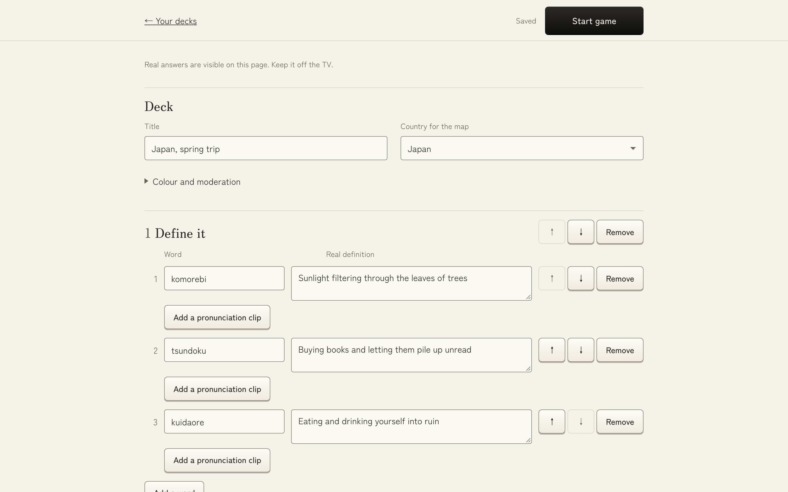

Open `/admin` and press **New deck**. Pick the country for the map, add games in any order, and fill them with your words and photos. Changes save as you type, and the builder lists anything that still needs fixing. Keep it off the TV, since it shows the real answers.

Photos are resized in the browser and stripped of their location and camera data before upload, and a photo's GPS location fills in its spot on the map. iPhone HEIC photos and MP4 or MOV videos work too.

[`docs/decks.md`](docs/decks.md) covers every game and setting.

## Running the show

The TV is the remote. Press a key once when the TV page opens, since browsers only allow sound after that.

| Key | |
| --- | --- |
| `Space` | Next. During a reveal or the podium, show everything at once. |
| `S` | Skip the timer, or skip to the vote while answers are shown one at a time |
| `+` | Add 15 seconds |
| `P` | Pause, or hold on the current answer |
| `M` | Mute. Remembered on that computer. |
| `L` | Lock or open joining |
| `R` | Show the players |
| `Y` / `N` | Let a guest back in on a new phone, or not |
| `H` | Hear a Define it clip again |
| `F` | Full screen. `F` or `Esc` leaves it. |
| `J` | Put the join QR code back up mid-game, for a guest who closed the page. `J` or `Esc` puts it away. |

Click an answer on the TV to hide it. Only the TV makes sound.

Guests can lock their phones, lose signal or refresh, and they come straight back to where they were. After the first visit, the app opens even on very weak signal and reconnects when it can.

## The look

The TV has no background pictures. Behind everything is a sky drawn from colours, in [`client/src/host/Scene.tsx`](client/src/host/Scene.tsx) and [`client/src/theme/scene.css`](client/src/theme/scene.css), with a different time of day for each part of the night: dusk in the lobby, daytime on each game's title card, night during rounds, sunset for the standings and a lantern-lit night for the podium. Clouds part between games. Anyone set to reduce motion gets a still version. A deck's accent colour tints the rest. The screenshots here were taken with photo backgrounds, which the game no longer has.

There is no background music: the TV makes its own beeps and chimes, and plays a word's clip when it has one. Each title card and standings screen pins up a GIF from Giphy, set in [`client/src/theme/gifs.ts`](client/src/theme/gifs.ts). The TV needs internet for the GIFs and word clips. Anything that can't load is left out.

## Development

```bash
npm run typecheck
npm test                  # unit tests
npm run test:integration  # a real server, with simulated TVs and phones
npm run test:e2e          # a TV and phones in real browsers
```

The browser tests need `npx playwright install chromium` once. They're slow and timing-sensitive, so CI runs everything except them. `/styleguide` shows the phone components at real sizes.

`npm run build && npm run capture` plays a whole game in headless browsers and remakes every screenshot and GIF in this README. It needs [ffmpeg](https://ffmpeg.org).

The server is [Fastify](https://fastify.dev) and [Socket.IO](https://socket.io), and the client is React, built with Vite. Code shared by both is in `shared/`. See [CONTRIBUTING.md](CONTRIBUTING.md) for how it fits together. To report a security problem, see [SECURITY.md](SECURITY.md).

## Credits

- Maps: [OpenFreeMap](https://openfreemap.org), with data from [OpenStreetMap](https://www.openstreetmap.org/copyright) contributors, drawn with [MapLibre](https://maplibre.org). Country outlines from [Natural Earth](https://www.naturalearthdata.com).
- Sample photos: Wikimedia Commons, all CC0. See [`server/sample-photos/CREDITS.md`](server/sample-photos/CREDITS.md).
- Fonts: Zen Kaku Gothic New, Zen Old Mincho, DotGothic16 and DSEG7, all under the SIL Open Font License. See [`client/src/theme/fonts/LICENSES.md`](client/src/theme/fonts/LICENSES.md).
- Word clips play from YouTube, and GIFs from Giphy; neither is included in this repository.

## License

[MIT](LICENSE). The license covers this repository's code. The sample photos and fonts keep their own terms.
